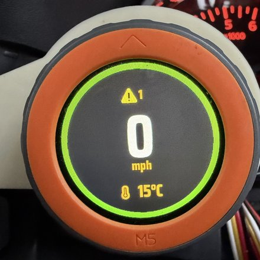
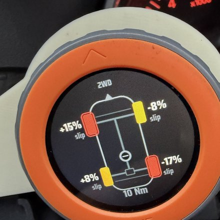
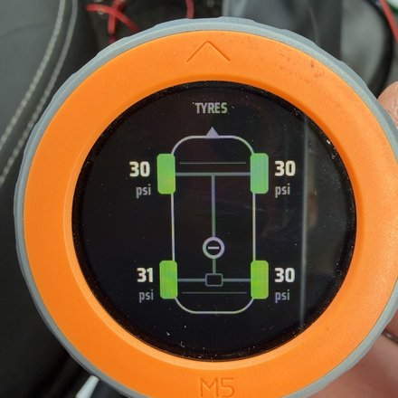
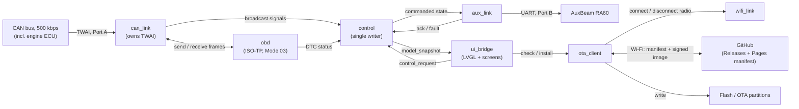

# Dacia Duster M5Dial UI

> Other than this paragraph, every line of code and documentation in this
> repository was written by Claude, as a real-world test of spec-driven AI
> development. I wrote and maintained the specification, did the initial
> manual CAN bus reverse engineering, wired up the hardware, and tested it
> all in the car. Claude Code did the rest.
>
> Matt

---

[](https://github.com/mjholmes/duster-m5dial-controller/actions/workflows/host-tests.yml)
[](https://github.com/mjholmes/duster-m5dial-controller/actions/workflows/release.yml)
[](LICENSE)

Firmware for an M5Stack M5Dial (ESP32-S3) fitted into a 2015 Dacia Duster's
instrument cluster: live CAN data (speed, outside temperature, DTC status,
tyre pressures, wheel slip, 4WD state) and control of two auxiliary lights
(more to follow) via an AuxBeam RA60. It also updates its own firmware over
Wi-Fi.

## What it does

| | |
|---|---|
|  | **Speedo** — speed, outside temperature, and a warning badge if the engine ECU has a stored fault code. |
|  | **4WD** — drive mode, coupler torque, and live per-wheel slip. |
|  | **Tyres** — all four TPMS pressures at a glance, colour-coded if one's low (or high). |

All data and warning states come from the vehicle's CAN bus. A manual
control screen drives the two RA60 outputs — LED light bar and aux fog
lights — either automatically (following the vehicle's own main beam /
front fog state) or manually.

Firmware updates itself: it checks a release channel (stable or beta) over
Wi-Fi, downloads and verifies a signed image, and installs it, with
automatic rollback if the new image fails to boot cleanly — no need to
remove it from the car for updates.

## Features and controls

| Input | Action |
|---|---|
| Swipe left / right | Step through the screens (wraps at both ends) |
| Swipe up / down | Jump straight to Speedo, from any screen |
| Tap the tyre-warning icon (on Speedo) | Jump straight to the Tyres screen |
| Rotate the encoder | Adjust display brightness — day or night level, whichever is currently active |
| Press the button | Short press: all lights off, MANUAL mode. Long press (~1s): AUTO mode |

Day/night brightness follows the vehicle's own dipped-beam signal on CAN,
not a clock or light sensor: dipped beam on → night brightness, off → day.
While main beam is on, the display holds whatever it was already showing —
the car's own CAN signal drops the dipped-beam bit during a main-beam
flash, so without that hold, flashing at night would briefly snap the
display to day brightness. Day and night levels are set independently with
the encoder and saved to flash a few seconds after you stop turning it.

A small comms-lost icon on Speedo shows `CAN`, `RA60`, or `BOTH` if the
vehicle CAN bus or the RA60 link drops out. It's a passive warning only —
unlike the tyre icon, there's no dedicated screen for it to jump to.

### How the timeouts work

Every piece of CAN/RA60 data has its own staleness window; past it, the
firmware treats the value as unavailable rather than leaving a stale number
on screen:

| Signal | Timeout | Effect |
|---|---|---|
| Lighting (0x5DE) | 750 ms | AUTO forces MANUAL, both lights off; comms icon shows `CAN` |
| Speed / outside temperature | 1000 ms | Shown as unavailable |
| TPMS, wheel speed, 4WD/ETC | 750 ms each | Tyres/4WD screens show `--` / no data |
| RA60 link (no valid ACK) | 1500 ms | Comms icon shows `RA60` |
| RA60 per-command ACK | 400 ms | One retry before the link timeout above counts it |

The Speedo tyre-warning icon adds its own debounce on top of the TPMS
staleness window above — it only raises after the warning condition has
held for 2 s, and only clears after 10 s clear, so one borderline reading
near a threshold doesn't flicker it on and off.

## How it's built



`can_link` is the only task that touches the TWAI peripheral. `obd`'s Mode
03 diagnostic requests go out over that same physical CAN bus, relayed
through `can_link` rather than over a second connection — there's only one
physical link to the vehicle. Similarly, `wifi_link` only turns the Wi-Fi
radio on and off; `ota_client` does its own HTTPS download over that radio
once it's up, rather than routing data through `wifi_link`.

- ESP-IDF (C) and FreeRTOS, LVGL 9 for the UI. No Arduino.
- A small set of single-purpose tasks, each with sole ownership of its
  hardware or library, talking through a snapshotted model (`control` is
  the only writer; everything else reads `model_snapshot()` or asks via
  `control_request()`).
- Light control goes through
  [`auxbeam-light-controller`](https://github.com/mjholmes/auxbeam-light-controller),
  a library maintained as a separate repository rather than folded into
  this one.
- The UI is authored in [EEZ Studio](https://www.envox.eu/studio/) and
  checked in at [`eez-studio/`](eez-studio/); firmware never hand-edits the
  generated output in `components/ui/`.
- CAN signals started from manual bus sniffing, then Claude cross-checked
  and extended that decoding by researching Renault's DDT4All diagnostic
  tool database (`ecu.zip`) and built the project's DBC from the combined
  result. Neither the DBC nor the working specification are in this repo.

## Hardware

- [M5Stack M5Dial](https://docs.m5stack.com/en/core/M5Dial) (ESP32-S3,
  round touch display, rotary encoder) as the controller and display. Built
  and tested on v1.0; v1.1 should work fine too.
- [AuxBeam RA60](https://www.auxbeam.com/) wireless relay switch, driven
  over UART, controlling an LED light bar and an auxiliary fog light.
- Vehicle CAN bus (500 kbps) tapped via the OBD-II port for speed,
  temperature, lighting state, TPMS, wheel speeds and 4WD/ETC status.

## Toolchain (pinned)

| Item | Version |
|---|---|
| ESP-IDF | **v5.5.5** (enforced by `idf: "==5.5.5"` in `main/idf_component.yml`) |
| LVGL | 9.5.0 (must match the EEZ Studio project setting) |
| M5Unified / M5GFX | 0.2.23 / 0.2.30 (board layer only, subject to the step 1 spike) |
| auxbeam-light-controller | **v0.1.1** git tag (public repo). Locked in `dependencies.lock` |

## Build

1. Install [ESP-IDF](https://docs.espressif.com/projects/esp-idf/en/stable/esp32s3/get-started/index.html)
   **v5.5.5** (the version pinned in `main/idf_component.yml`; other 5.x
   versions aren't guaranteed to work) and source its environment script:
   ```
   . ~/esp/esp-idf/export.sh
   ```
2. Clone this repository and set the target chip:
   ```
   git clone https://github.com/mjholmes/duster-m5dial-controller.git
   cd duster-m5dial-controller
   idf.py set-target esp32s3
   ```
3. Build. The IDF Component Manager fetches `auxbeam-light-controller`
   (public repo, pinned to `v0.1.1` in `dependencies.lock`) automatically —
   no extra setup needed just to build:
   ```
   idf.py build
   ```
4. Flash over USB and watch the log:
   ```
   idf.py -p /dev/ttyACM0 flash monitor
   ```
   (`/dev/ttyACM0` is the usual port on Linux; adjust for your OS.)

Host tests are separate from the firmware build and need their own sibling
checkout of the library source (see [Host tests](#host-tests), below).

## Installing it yourself

To run this on your own M5Dial rather than building from source:

1. **First flash is always over USB.** A blank board has no bootloader or
   partition table yet, and only a full source build produces those — so
   even if you never touch USB again afterwards, do the [Build](#build)
   steps once to get the device flashed and running.
2. **Set Wi-Fi credentials**, needed for OTA updates (Wi-Fi is otherwise
   off — see [How it's built](#how-its-built)). With the device connected,
   open a serial terminal on it (`idf.py -p /dev/ttyACM0 monitor`, or any
   terminal program) and at the `duster>` prompt:
   ```
   wifi set <ssid> <psk>
   ```
   Credentials are stored in NVS and survive OTA updates; `wifi show` and
   `wifi clear` are also available.
3. **Updates after that are over the air**: on the device, swipe to the
   update screen and use Check for update / Install. Signed builds are
   published automatically to this repo's
   [Releases page](https://github.com/mjholmes/duster-m5dial-controller/releases)
   on tagged commits (see `.github/workflows/release.yml`).

One catch worth knowing: the firmware only trusts an OTA update signed with
the same key as whatever image is currently running — there's no separate
embedded public key to pre-load. The signing key itself never leaves this
repo's GitHub Actions environment, so a locally-built image (step 1) can't
be made to trust OTA updates the same way a CI-built release can. If you
want OTA to work from day one, your options are flashing a CI-built image
over USB for that first install, or just accepting that first-party tools
(USB reflash) are how you'll update your own builds going forward.

## Host tests

Pure logic (control core, button handling, CAN decode, tyre/slip math) is tested off-target:

```
cmake -S test/host -B build-host && cmake --build build-host && ./build-host/host_tests
```

The RA60 state machine tests (`aux_tests`) additionally compile the real
[`auxbeam-light-controller`](https://github.com/mjholmes/auxbeam-light-controller)
sources, which need a sibling checkout of that repo next to this one, at
matching tag `v0.1.1`.

## EEZ UI

The UI is built with [EEZ Studio](https://www.envox.eu/studio/), a free,
open-source LVGL GUI editor. The project is checked in at
[`eez-studio/duster-m5dial-ui.eez-project`](eez-studio/) and is the source
of truth for the UI — open and edit it there. It generates `components/ui/`,
which is never edited by hand; `ui_bridge` compiles it, and `idf.py
reconfigure` picks up any export that adds or removes files.
